<p align="center">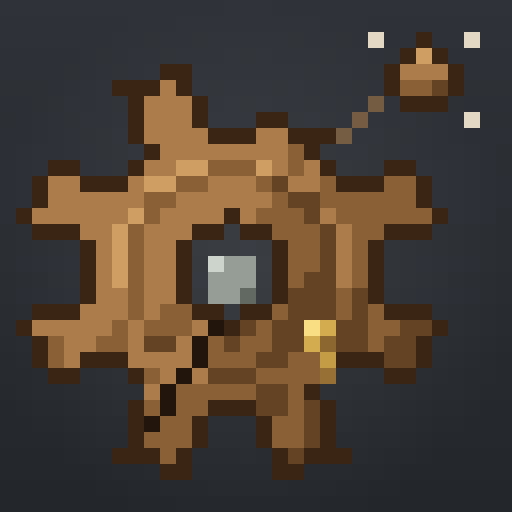</p>

# Create: Wear & Tear (Износ и поломки)

Аддон для **Create 6** на **Minecraft 1.21.1 / NeoForge**. Механические детали изнашиваются, ломаются от неправильной эксплуатации и требуют замены. Закалочный состав, сваренный в чаше механическим смешивателем, продлевает им жизнь.

English description for Modrinth: [MODRINTH.md](MODRINTH.md).

| | |
|---|---|
| Minecraft | 1.21.1 |
| NeoForge | 21.1.219 и новее |
| Create | 6.0.10 и новее (до 6.1) |
| Мод-ид | `create_wear` |

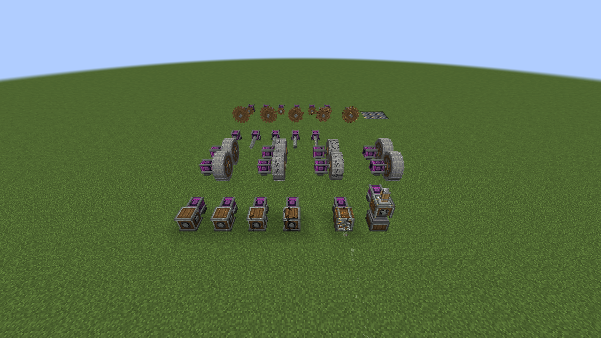

## Как это работает

### Износ
Каждая вращающаяся деталь из профиля износа копит износ, пока крутится. Быстрее всего изнашиваются **шестерни**: при 64 об/мин маленькая живёт около 2,5 часа игры, большая около 3 часов. Валы, редукторы и машины служат дольше. У каждой детали случайное «качество» ±25%, поэтому завод не встаёт разом.

| Стадия | Износ | Как выглядит |
|---|---|---|
| Как новая | 0–30% | оригинальный вид Create |
| Поцарапана | 30–65% | светлые царапины с бликом, задиры, потёртые углы |
| Сильно изношена | 65–100% | грязь, первые трещины, у шестерён отламываются первые зубья |
| Сломана | 100% | глубокие трещины, сколы, зубья стёрты до обрубков |

У каждой детали один из трёх вариантов износа, он выбирается по её координатам. Поэтому две соседние шестерни трескаются по-разному, а 16 пластин дробильного колеса берут разные плитки с трещинами в разных местах.

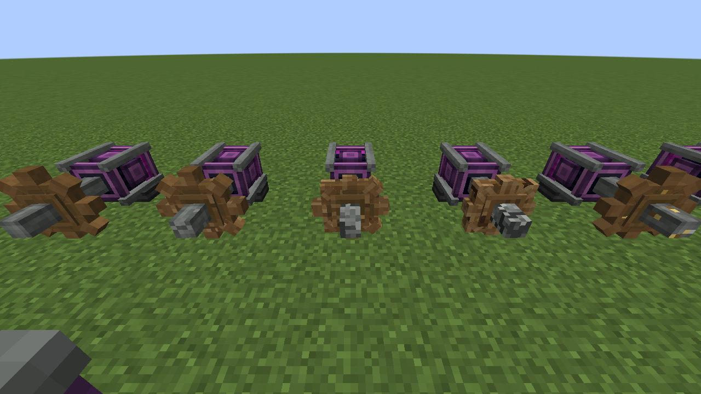
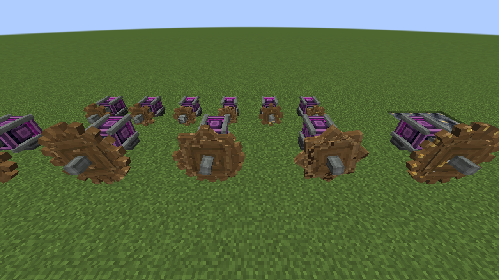
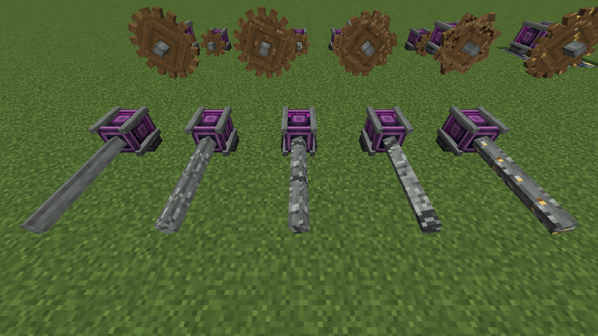

### Отлетающие зубья
Когда шестерня переходит в следующую стадию, её зубья обламываются по одному. Каждый зуб отлетает по касательной к вращению настоящим деревянным брусочком, падает, пару раз подпрыгивает и исчезает. На модели на его месте остаётся обрубок.

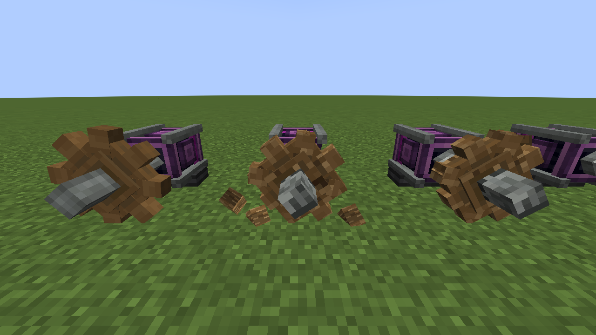
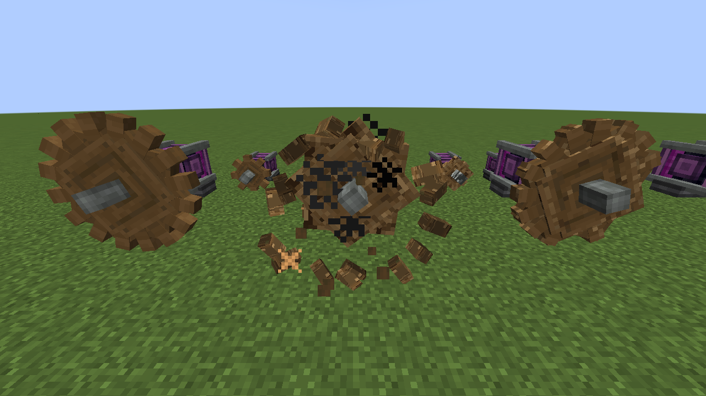

### Что ускоряет износ (неправильная эксплуатация)
- **Превышение скорости.** У каждой детали есть номинальная скорость (шестерня 128, большая шестерня 96 об/мин и т. д.). Выше неё износ растёт резко.
- **Передаточное число.** Ведомая деталь в передаче 2:1 нагружена сильнее. Сильнее всего страдает большая шестерня над контроллером скорости при 16 → 256 об/мин.
- **Перегрузка сети.** Если сеть загружена больше чем на 75% от мощности, детали изнашиваются быстрее.
- **Рывки.** Реверс под нагрузкой (256 → −256) сразу снимает до 6% ресурса, резкий скачок скорости до 3%. Слышен удар и видны искры.
- **Коррозия.** Детали в воде (waterlogged) изнашиваются на 30% быстрее.
- **Проскальзывание дробильных колёс.** Если пара колёс крутится с разной скоростью (например, 20 и 50 об/мин), их пластины стираются за пару минут. Изношенные колёса дробят медленнее, а стёртые до гладкости только крутятся.

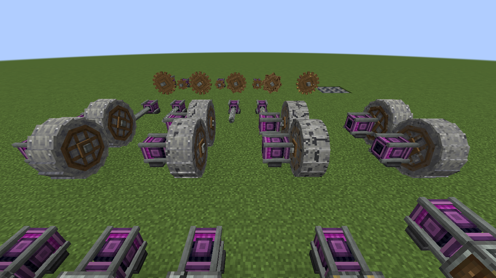

### Поломка
- **Шестерни и цепные приводы** (`teeth`): зубья стёрты. Деталь ещё крутится вместе со своим валом, но больше не передаёт вращение зацепленным шестерням и цепям.
- **Валы, редукторы, машины** (`seize`): деталь заклинивает, и она перестаёт передавать вращение куда-либо. Машина останавливается.
- **Дробильные колёса** (`smooth`): пластины стёрты до круга, колесо вращается, но не дробит.

У каждой поломки свой звук: треск дерева, лязг металла или скрежет камня. Отдельно звучат щелчок отлетающего зуба, стук упавшего обломка, удар рывка и скрежет сильно изношенной детали. Все звуки с субтитрами.

Сломанную деталь нужно сломать и поставить новую. Из неё выпадает **металлолом**, а не сама деталь, и его можно раздробить. Частично изношенная деталь при добыче (киркой или гаечным ключом) **сохраняет износ** в предмете, поэтому «перепоставить» её не поможет. То же касается обшивки корпусом и снятия корпуса.

Корпуса (редукторы, обшитые валы и шестерни, пресс, смешиватель, вентилятор и т. д.) показывают износ царапинами и трещинами поверх блока.

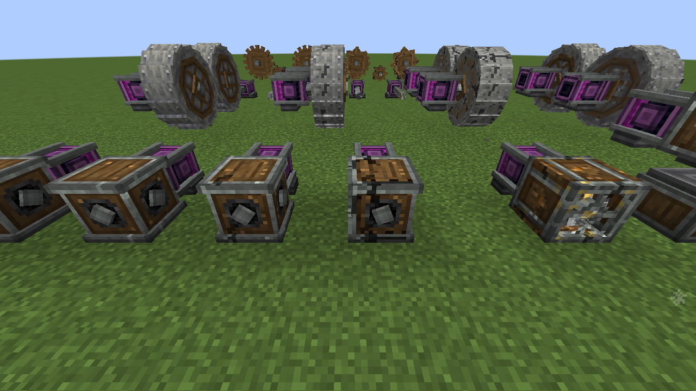

### Очки инженера
В очках видно состояние детали, причины ускоренного износа и примерное время до поломки. На сломанную деталь подсказка появляется и без очков.

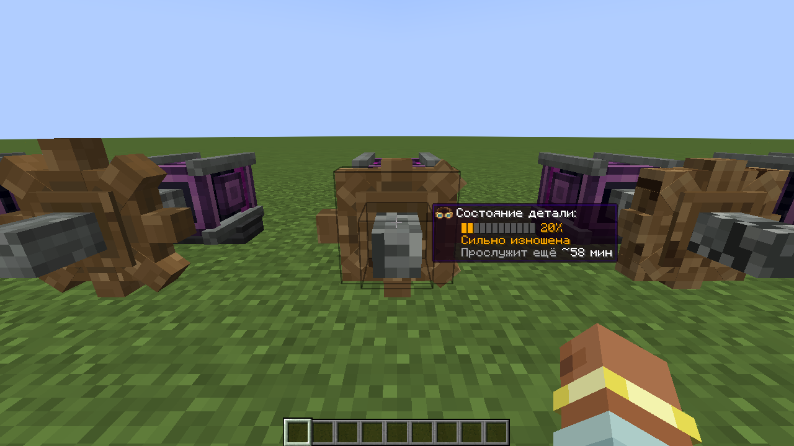
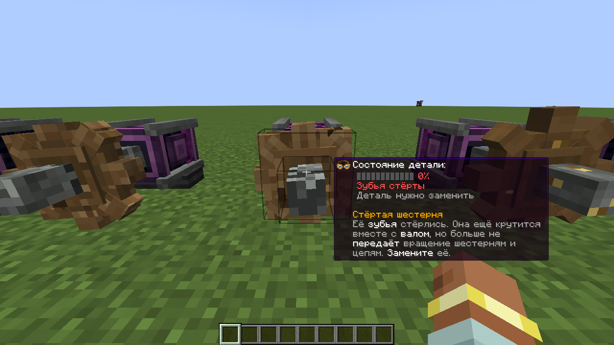
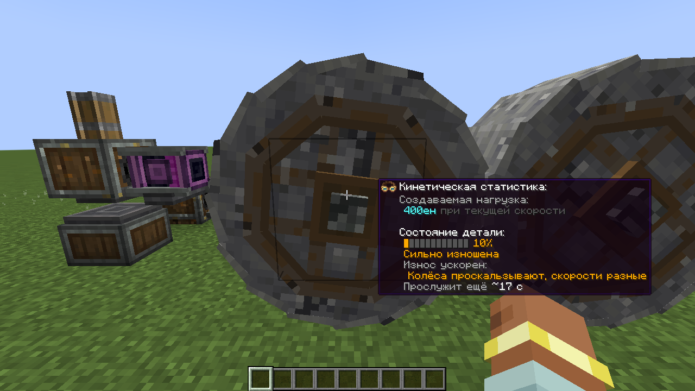

## Закалочный состав

1. Сделайте андезитовый сплав, добудьте золото и железо.
2. Залейте **1000 мВ воды** в чашу, бросьте **андезитовый сплав, золотой слиток и железный слиток**.
3. Перемешайте **механическим смешивателем** (нагрев не нужен), получится 1000 мВ закалочного состава.
4. Наберите его **ведром** из чаши.
5. **ПКМ ведром по установленной детали**: она станет закалённой, а ведро опустеет.

Закалённая деталь изнашивается примерно втрое медленнее и вдвое легче переносит рывки. На ней появляются небольшие золотистые следы состава. Сломанную деталь уже не спасти.

Для автоматизации: **дозатор** покрывает новые детали-предметы на конвейере или депо, 250 мВ на штуку. Изношенные предметы он не принимает.

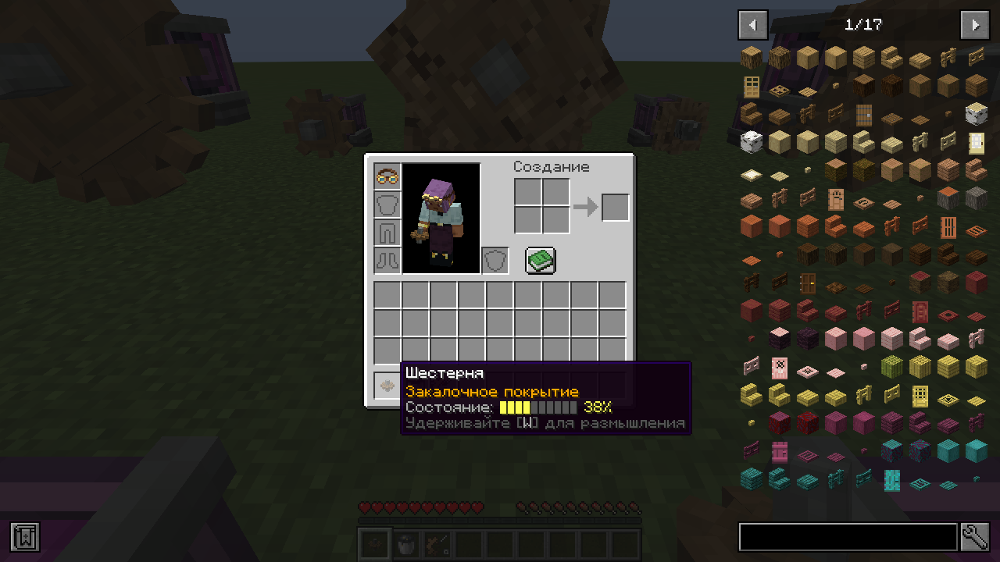
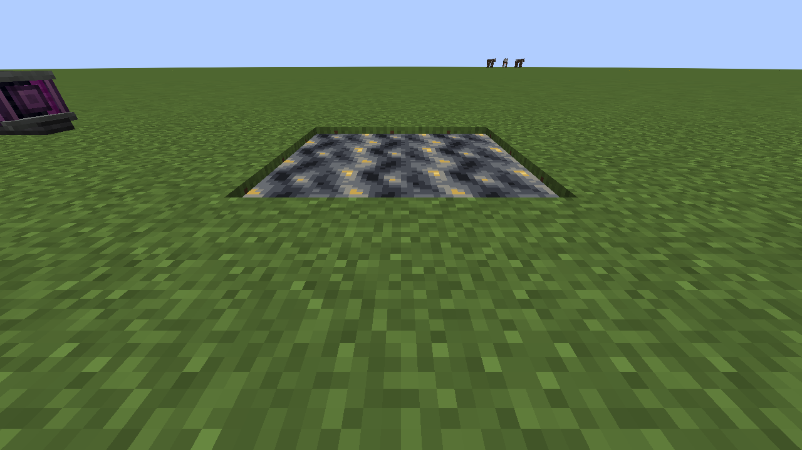

## Настройка

`config/create_wear-server.toml` (у сервера, синхронизируется клиентам): общий множитель износа, опорная скорость, разброс качества, эффект закалки, штрафы за перегрузку, скорость, передачу и воду, урон от рывков, скорость стирания дробилок, разрушение сломанных деталей и выпадение лома.
`config/create_wear-client.toml`: частицы, звуки, наложение царапин и дальность их отрисовки.

### Свои профили износа (датапак)
Какие блоки изнашиваются, задаётся data map `data/create_wear/data_maps/block/wear_profiles.json`. Его можно дополнить или переопределить датапаком, в том числе для блоков других аддонов:

```json
{
  "values": {
    "create:cogwheel": { "lifetime": 150, "rated_speed": 128, "failure": "teeth" },
    "mymod:turbine_shaft": { "lifetime": 600, "rated_speed": 256, "failure": "seize" }
  }
}
```
`lifetime` задаётся в минутах работы на опорной скорости (64 об/мин), `failure` принимает значения `teeth`, `seize` или `smooth`.

### Команды (уровень оператора 2)
```
/createwear get <pos>
/createwear set <pos> <0..100>
/createwear repair <pos>
/createwear reinforce <pos> [true|false]
```

## Откуда берутся изношенные модели
В jar нет ни текстур, ни моделей Create. Изношенные текстуры, модели с отдельными зубьями и сетка круглого дробильного колеса генерируются в памяти при загрузке ресурсов из Create, установленного у игрока (`client/assets/WornAssets`), это занимает около половины секунды. Поэтому вид сам подстраивается под установленную версию Create.

## Сборка и проверка

```bash
./gradlew build
```
Jar появится в `build/libs/`.

```bash
./gradlew runGameTestServer
```
Это 14 автотестов на настоящем Create: стёртая шестерня перестаёт крутить соседей, заклинивший редуктор, проскальзывание дробилок, реверс, превышение скорости, передаточное число, ведро, лут, установка изношенного предмета, сохранение/загрузка, обшивка корпусом, полный рецепт в смешивателе и рецепт дозатора.

```bash
./gradlew previewAssets
```
Прогоняет генератор изношенных ассетов вне игры и пишет результат в `build/asset-preview`.

```bash
python3 tools/generate_assets.py
```
Рисует жидкость, слой ведра и металлолом.

```bash
python3 tools/generate_sounds.py
```
Синтезирует звуки (нужен ffmpeg с libvorbis).

```bash
python3 tools/make_icon.py
```
Рисует иконку проекта.

```bash
python3 tools/generate_data.py
```
Генерирует рецепты, профили и лут-модификатор.

## Лицензия
Код, звуки и графика этого мода распространяются по лицензии MIT. Ассеты Create (All Rights Reserved, The Create Team) в мод не входят: изношенные варианты строятся на компьютере игрока из его собственной копии Create.
